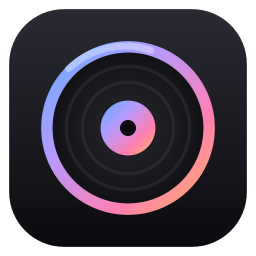
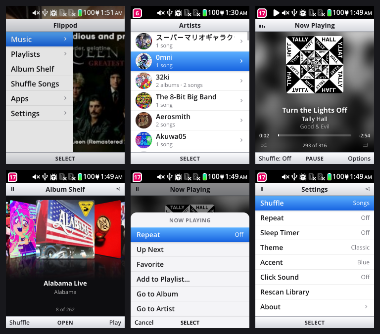

# Flippod

A music player and home screen for the **TCL Flip 4 5G** (KaiOS 4.0), built for the keypad and a 240×320 screen.





## Features

- **Library**: Artists, Albums, Songs, Genres, Folders, Recently Added, Favorites and Most Played, built from your tags. It reads ID3v2.2–2.4, ID3v1, MP4/M4A, FLAC and Ogg/Opus, plus embedded or folder cover art.
- **Playlists**: `.m3u`/`.m3u8` files in the music folder are imported automatically. You can also make your own playlists on the phone.
- **Now Playing**: blurred-art backdrop, a cover that slides in when the track changes and shrinks when paused, scrubbing, and a title that scrolls if it's too long.
- **Album Shelf**: a 3D cover browser.
- **Playback**: shuffle, repeat, Up Next, Play Next, a sleep timer, headset/Bluetooth buttons, pause on headphone unplug, and the queue and position survive reboots.
- **Home screen**: replaces the stock launcher, with an Apps menu to open everything else.
- **Themes**: Classic, Midnight and Album Color, with six accent colors.

## Keys

| Where | Key | Action |
|---|---|---|
| Lists | Up / Down (hold to speed up) | Move |
| Lists | 2–9 | Jump by letter (press again for the next letter) |
| Lists | Enter / Back | Open / go back |
| Song lists | Left softkey | Shuffle this list |
| Song lists | Right softkey | Options (Play Next, Add to Playlist, Favorite…) |
| Now Playing | Enter | Play / pause |
| Now Playing | Left / Right | Previous / next (hold to seek) |
| Now Playing | 0–9 | Jump to 0–90% of the song |
| Now Playing | Up / Down | Up Next / go to album |
| Album Shelf | Left / Right | Browse (Enter opens, right softkey plays) |
| Anywhere | Call | Jump to Now Playing |

## Putting music on the phone

Copy music into the phone's **`music`** folder (`/data/media/music`, which the phone also calls `/sdcard/music`). Subfolders are fine.

- **USB (MTP):** plug the phone in. It shows up as *Internal → music* in your file manager.
- **adb:** `adb push ~/Music/MyAlbum /data/media/music/` (needs `adb root`).

Flippod picks up new files on its own, or you can use *Settings → Rescan Library*.

## Install

Requirements: a TCL Flip 4 with `adb root` (see [tcl-flip-4-root](../tcl-flip-4-root)).

```bash
tools/deploy.sh          # build + install/update the app
tools/homescreen.sh on   # make Flippod the home screen (off = stock launcher)
```

KaiOS hardcodes the home screen to `launcher.localhost`, so `homescreen.sh` repoints the `/data/local/webapps/vroot/launcher` symlink to Flippod and restarts the UI. To undo it, run `tools/homescreen.sh off`.

## Development tools

- `tools/rdp.py`: minimal Firefox Remote Debugging Protocol client for the phone (`tabs`, `eval <tab> <js>`)
- `tools/shot.py`: screenshot either display (`shot.py out.png [outer]`)
- `tools/key.py`: inject key presses (`key.py Down Down Enter hold:Right:20`)
- `tools/wake.py`: wake the screen / release the dev wake lock
- `tools/gen-apps.py`: regenerate the Apps list from the phone
- `tools/test-tags.mjs`: run the tag reader against a folder on the laptop

## Notes and limits

- KaiOS renders at 30 fps by default (`layout.frame_rate`). All motion is GPU-friendly, but that cap still applies.
- The outer display is drawn by the system app and can't show Flippod's now-playing info.
- CSS `mask-image` hides text inside animated elements on this Gecko build, so it isn't used.

## License

AGPL-3.0-or-later
